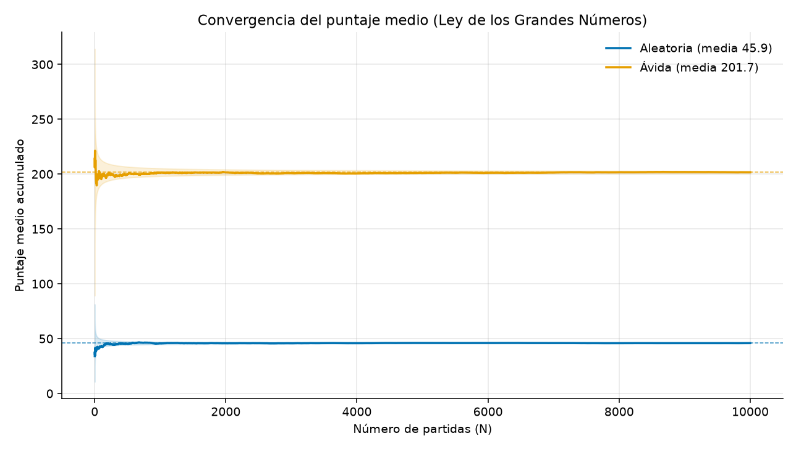
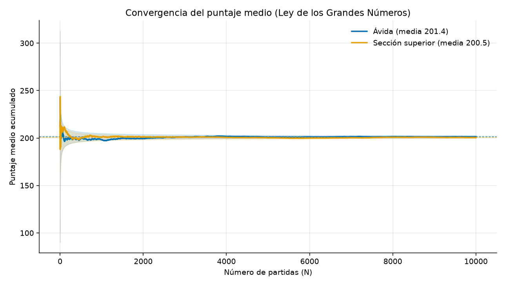
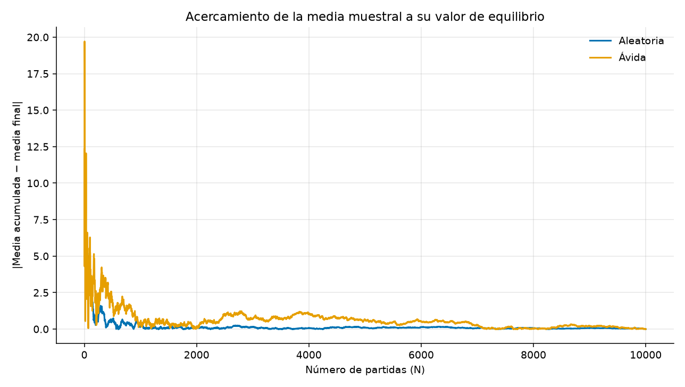
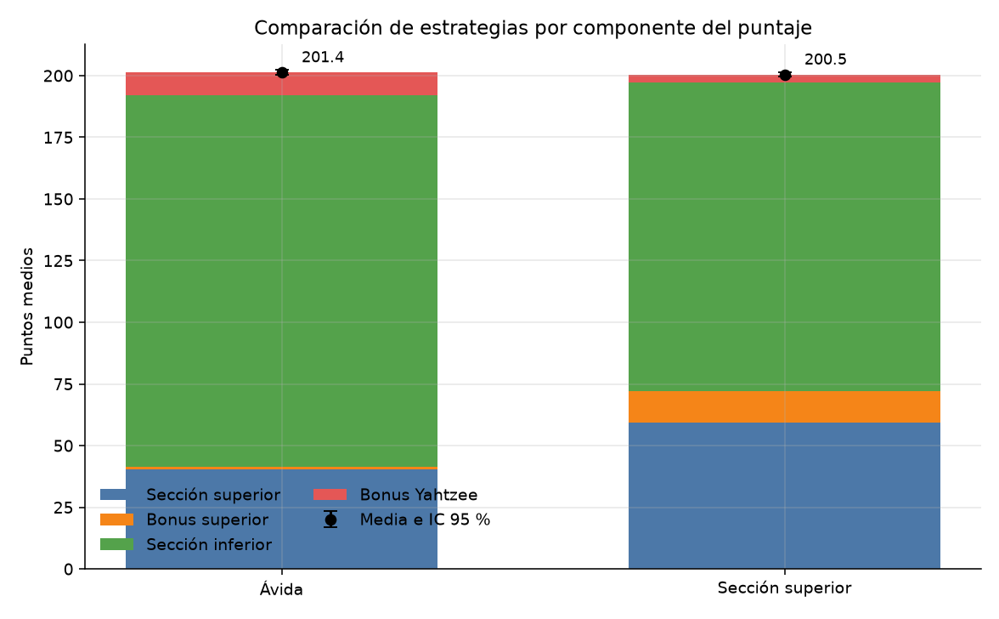
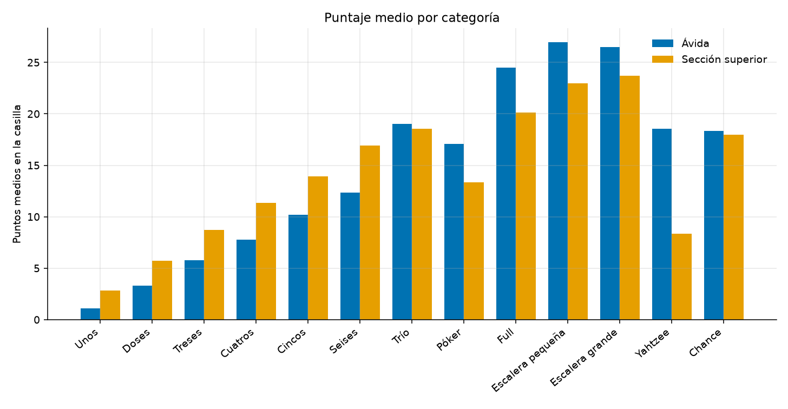
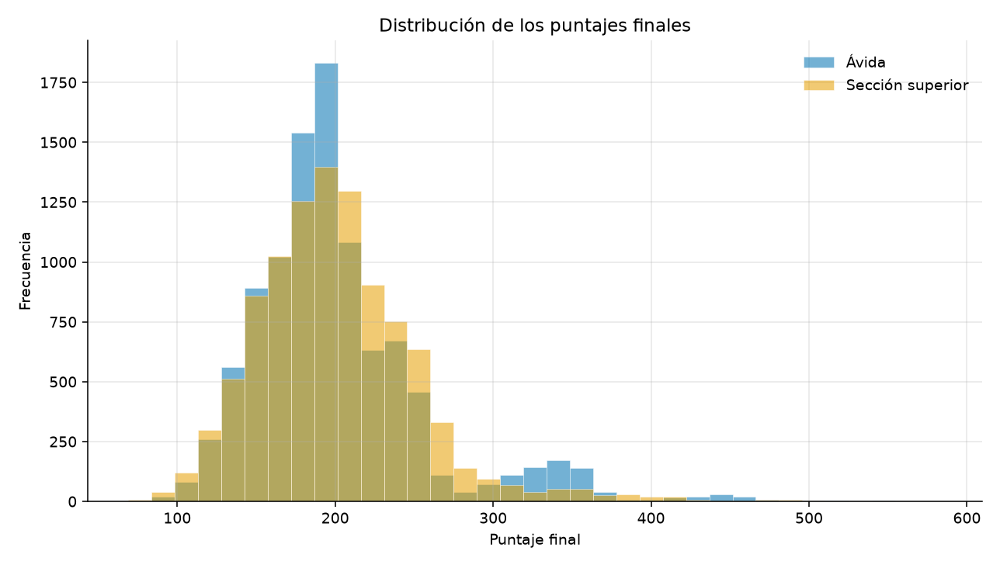
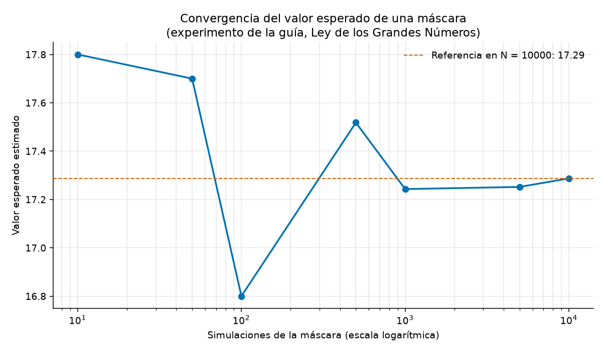
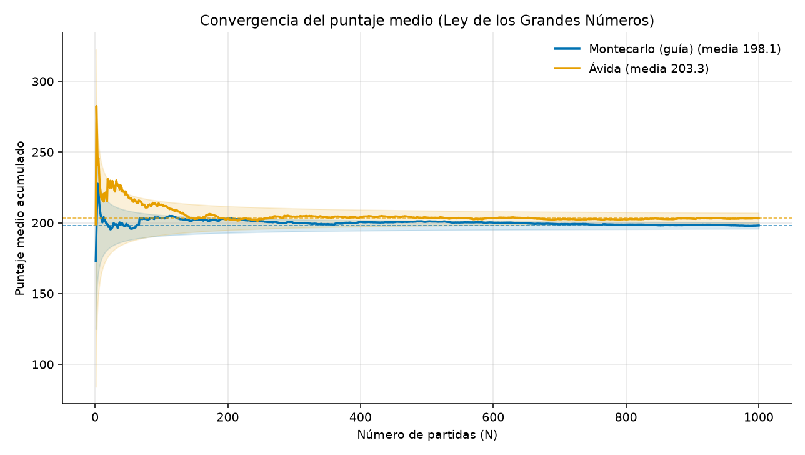

# Simulación del Yahtzee clásico mediante el método de Montecarlo

**Asignatura:** Simulación  
**Estudiante:** Paul  
**Programa:** Semestre V, IU Digital  
**Fecha:** octubre de 2026  
**Estado:** borrador. Completar el apellido en la portada y exportar a PDF con el nombre `Apellido_Paul_Montecarlo.pdf`.

---

## 1. Introducción

El método de Montecarlo estima una cantidad difícil de calcular de forma cerrada repitiendo un experimento aleatorio y promediando lo observado. En un juego de dados, esa cantidad es el puntaje que cabe esperar si se sigue siempre la misma forma de decidir.

Yahtzee se juega con cinco dados de seis caras. En cada turno hay hasta tres lanzamientos: entre uno y otro se pueden conservar algunos dados y volver a lanzar el resto. Al terminar el turno se cierra exactamente una de trece categorías. Una partida dura trece turnos por jugador. Gana quien suma más puntos, contando el bonus de la sección superior y los bonuses de Yahtzee adicional.

El objetivo de este trabajo es simular partidas completas entre dos jugadores, repetirlas miles de veces y mostrar que el puntaje medio de cada estrategia se estabiliza. Esa estabilización es la Ley de los Grandes Números: si las partidas son independientes y de la misma distribución, y el puntaje tiene esperanza finita, la media muestral se acerca a la esperanza de la estrategia cuando el número de partidas crece.

## 2. Metodología

### 2.1 Material de partida y ciclo USA, MODIFICA, CREA

El profesor entregó tres piezas, y el trabajo declara qué se tomó de cada una.

| Guía | Qué hace | Qué no hace |
|------|----------|-------------|
| `simulacion_01.ipynb` | Partida de dos jugadores. En cada relanzamiento prueba las 32 formas de conservar dados y estima, con muestras aleatorias, el puntaje de la mejor categoría. También mide el tiempo según el número de muestras y la convergencia del valor esperado de una máscara. | No suma el bonus de 35 ni el Yahtzee de +100. Con un solo relanzamiento pendiente, la cuenta de tiradas futuras llega a cero: todas las máscaras empatan y el código suelta los cinco dados. Los dos jugadores usan la misma política, así que no hay con qué compararla. La Ley de los Grandes Números se ilustra en una sola decisión, no en el puntaje de la partida. |
| `Laboratorio Yahtzee.jsx` | Tablero para dos personas: tres lanzamientos, bloqueo de dados y trece categorías. | Las decisiones las toma el usuario. No hay motor de Montecarlo ni bonus superior. |
| `Laboratorio Yahtzee Montecarlo.html` | Explica el objetivo del laboratorio y que cada cara del dado sale con probabilidad 1/6. | Es material de lectura, no el simulador. |

Sobre esa guía el desarrollo hizo tres pasos.

1. **USA.** Se conservó el núcleo del cuaderno: cinco dados, dos jugadores, trece turnos y la elección de bloqueo por las 32 máscaras. La estrategia `montecarlo` está en `src/guide_montecarlo.py`.
2. **MODIFICA.** La tarjeta aplica el bonus de 35 y el comodín de Yahtzee. El último relanzamiento sí se simula, y si ninguna máscara mejora el puntaje actual el jugador se planta. Cada partida tiene su propia semilla, en lugar del `random` global del cuaderno. Se añadieron además dos políticas legibles, la ávida y la de sección superior, para tener con qué comparar a la de la guía.
3. **CREA.** El mismo partido se repite miles de veces. El programa exporta cada partida, dibuja la media acumulada y compara estrategias. Además se replicó el experimento de convergencia del cuaderno (valor esperado de conservar dos treses) y se extendió la Ley de los Grandes Números al puntaje de la partida completa, que es la cantidad que define al ganador.

### 2.2 Diseño

La aplicación está en Python 3.12 y se organiza así:

| Módulo | Responsabilidad |
|--------|-----------------|
| `dice.py` | Lanzar cinco dados y relanzar los no conservados |
| `scorecard.py` | Validar casillas, puntuar y aplicar bonuses |
| `player.py` | Tarjeta del jugador y estrategia de decisión |
| `game.py` | Trece rondas, dos jugadores y ganador |
| `simulator.py` | N partidas independientes |
| `analysis.py` | Medias, intervalos, CSV, JSON y figuras |

Los puntajes de los dos jugadores no se afectan: cada uno tiene sus dados y su tarjeta. La partida solo es competitiva al comparar los totales. Por eso la media de una estrategia estima su valor esperado aunque comparta la mesa con otra política.

### 2.3 Reglas implementadas

- Cinco dados y como máximo tres lanzamientos por turno.
- Trece categorías. La sección superior paga la suma de los dados del número elegido. Trío y póker pagan la suma de los cinco dados; full, 25; escalera pequeña, 30; escalera grande, 40; Yahtzee, 50; chance, la suma de los cinco dados.
- Si no se cumple la categoría, se anota cero. Hay que cerrar una casilla igual.
- Bonus superior: 35 puntos si la sección alta suma al menos 63.
- Yahtzee adicional, en la versión simplificada del proyecto: si sale un Yahtzee y la casilla ya vale 50, se suman 100 puntos. La tirada debe anotarse en la casilla superior de ese número si sigue abierta; si no, en cualquier casilla inferior abierta, que entonces puntúa como comodín. Si la casilla Yahtzee está en cero, el comodín se mantiene y el bonus de 100 no se otorga. Si no queda casilla inferior, se escribe cero en otra casilla superior abierta.

Estas reglas tienen pruebas automáticas en `tests/` (33 pruebas: puntuación, umbral 63, comodín, bonus de 100, partida completa y reproducibilidad con la misma semilla).

### 2.4 Estrategias

**Montecarlo de la guía.** Prueba las 32 máscaras. Para cada una relanza muchas veces los dados libres y promedia el mejor puntaje legal. Conserva la máscara cuyo promedio supera al de plantarse. Al cerrar el turno anota la casilla de más puntos, con el mismo desempate del cuaderno (primero las categorías de arriba). En los experimentos se usaron 24 muestras por máscara: el cuaderno proponía 300, suficientes para una partida, y demasiado lentas para repetir el partido mil veces. Como la máscara queda fija durante la simulación, varias repeticiones del relanzamiento tienen la misma distribución que una sola; por eso cada muestra tira una vez.

**Aleatoria.** Después de cada lanzamiento conserva cada dado con probabilidad 1/2 y siempre usa los tres lanzamientos, salvo que el azar conserve los cinco. Al final elige con igual probabilidad una casilla legal. No interpreta los dados. Sirve de línea base frente a cualquier política que sí lee la tirada.

**Ávida.** Conserva un trío o más, una pareja, las dos parejas si busca full, o la secuencia consecutiva más larga. Se planta si ya tiene Yahtzee o escalera grande, y también en el segundo lanzamiento si la mejor casilla legal vale al menos 25. Anota la casilla de mayor puntaje; si todas valen cero, sacrifica primero las de menor utilidad (unos, doses, Yahtzee, etc.).

**Sección superior.** El bonus exige 63 puntos arriba, el equivalente a tres dados de cada número. Mientras esa sección está abierta, la política conserva la cara abierta que más aparece, siempre que haya al menos una pareja, y acepta una casilla superior en cuanto alcanza tres o más dados de ese número. Una casilla inferior solo se prefiere si paga 25 o más, o si ya no queda una opción superior razonable. Al anotar cero, intenta no gastar seises, cincos ni cuatros.

Ninguna de las tres resuelve el juego por programación dinámica. El jugador óptimo de solitario, calculado por Verhoeff y precisado después, tiene una esperanza de aproximadamente **254,59** puntos. Las heurísticas de este trabajo quedan por debajo de esa cota, y el informe usa esa cifra solo como referencia externa, no como resultado de la simulación.

### 2.5 Diseño del experimento

Se hicieron dos experimentos de **10 000 partidas** cada uno. Cada partida usa un generador nuevo, derivado de una semilla maestra, así que las partidas son independientes e idénticamente distribuidas dada la pareja de estrategias.

| Experimento | Semilla | Jugador 1 | Jugador 2 |
|-------------|---------|-----------|-----------|
| 1 | 42 | Aleatoria | Ávida |
| 2 | 43 | Ávida | Sección superior |

Para un puntaje medio se reporta la desviación estándar muestral y el intervalo de confianza aproximado al 95 %:

\[
\bar{x} \pm 1{,}96 \cdot \frac{s}{\sqrt{N}}
\]

Con \(N = 10\,000\) ese intervalo es estrecho. La banda sombreada de las gráficas de convergencia usa la misma idea: alrededor de la media final de la muestra se dibuja \(\pm 1{,}96\, s / \sqrt{N}\), que se estrecha conforme crece N.

Herramientas: Python 3.12, NumPy (generadores PCG64 y arreglos de resultados) y Matplotlib. No hay interfaz gráfica de juego; la salida analítica son CSV, JSON y PNG. Comando de reproducción:

```text
python main.py --suite --partidas 10000 --semilla 42
```

## 3. Resultados

### 3.1 Puntaje medio y dispersión

**Experimento 1. Aleatoria contra ávida** (N = 10 000, semilla 42).

| Estrategia | Media | DE | Mediana | Mín. | Máx. | IC 95 % | Bonus superior | Yahtzees por partida | Victorias |
|------------|------:|---:|--------:|-----:|-----:|---------|---------------:|---------------------:|----------:|
| Aleatoria | 45,93 | 18,02 | 42 | 11 | 139 | [45,57; 46,28] | 0,00 % | 0,010 | 2 |
| Ávida | 201,69 | 57,39 | 192 | 79 | 711 | [200,57; 202,82] | 2,06 % | 0,492 | 9 998 |

No hubo empates. La estrategia ávida gana casi siempre. La diferencia de medias es de unos 156 puntos y los intervalos no se acercan.

**Experimento 2. Ávida contra sección superior** (N = 10 000, semilla 43).

| Estrategia | Media | DE | Mediana | Mín. | Máx. | IC 95 % | Bonus superior | Yahtzees por partida | Victorias |
|------------|------:|---:|--------:|-----:|-----:|---------|---------------:|---------------------:|----------:|
| Ávida | 201,39 | 56,80 | 191 | 78 | 584 | [200,27; 202,50] | 2,05 % | 0,489 | 4 791 |
| Sección superior | 200,47 | 50,84 | 196 | 69 | 553 | [199,47; 201,47] | 36,12 % | 0,499 | 5 146 |

Hubo 63 empates (0,63 %). La diferencia de medias (ávida menos sección superior) es de **0,91** puntos. En las partidas emparejadas, el intervalo de confianza al 95 % de esa diferencia es **[-0,58; 2,41]**: incluye el cero. Con 10 000 partidas no hay evidencia de que una esperanza supere a la otra. Sí cambia la forma del puntaje: la sección superior gana un poco más a menudo (51,46 % frente a 47,91 %) y su mediana es más alta (196 frente a 191), mientras la ávida conserva una cola derecha más larga, visible en el máximo y en la desviación estándar.

La media ávida del experimento 1 (201,69) y la del experimento 2 (201,39) provienen de muestras independientes. Coinciden dentro de sus intervalos. Esa repetición es otra comprobación de que la estimación ya no depende del azar particular de una tanda.

### 3.2 Convergencia y Ley de los Grandes Números

Media acumulada en cortes de N, experimento 1:

| N | Aleatoria | Ávida |
|--:|----------:|------:|
| 50 | 42,04 | 197,10 |
| 100 | 43,04 | 195,75 |
| 250 | 45,06 | 199,94 |
| 500 | 45,38 | 199,70 |
| 1 000 | 45,73 | 201,26 |
| 2 000 | 45,79 | 201,53 |
| 5 000 | 46,02 | 201,04 |
| 10 000 | 45,93 | 201,69 |

Desde N = 1 000, la media aleatoria se mueve menos de medio punto y la ávida menos de un punto respecto del valor en N = 10 000. Al principio, en cambio, una sola tanda de 50 partidas desplaza la media ávida varios puntos (197 en un experimento y 207 en el otro).





Las dos curvas de cada figura dejan de oscilar y quedan dentro de una banda cada vez más estrecha. La segunda figura es especialmente clara: dos estrategias distintas se separan al comienzo y, después de unos miles de partidas, sus medias quedan prácticamente quietas, a una décima de distancia.



Esta última gráfica mide la distancia entre la media acumulada y la media de las 10 000 partidas. Termina en cero porque el último punto es esa misma media: el dato útil no es el extremo, sino que la distancia ya es pequeña mucho antes. Para la estrategia ávida, saltos de más de 10 puntos al inicio quedan por debajo de 1 punto desde aproximadamente N = 2 000.

La anchura del intervalo también sigue la tasa \(1/\sqrt{N}\). Con una desviación cercana a 57, la mitad del intervalo ávido mide unos 11 puntos cuando N = 100 y unos 1,1 puntos cuando N = 10 000. Diez mil partidas estiman la esperanza con una precisión de alrededor de un punto.

### 3.3 De qué está hecho el puntaje



En el experimento 2 las medias totales casi coinciden, pero no se componen igual.

| Componente | Ávida | Sección superior |
|------------|------:|-----------------:|
| Sección superior | 40,54 | 59,44 |
| Bonus superior (promedio, incluido el cero) | 0,72 | 12,64 |
| Sección inferior | 150,87 | 125,03 |
| Bonus de Yahtzee adicional | 9,26 | 3,36 |
| **Total** | **201,39** | **200,47** |

La política de sección superior sube unos 19 puntos en la parte alta y unos 12 en el bonus de 35. Los pierde, casi punto por punto, en la parte baja y en los Yahtzee de 100. El bonus aparece en el 36,1 % de sus partidas y solo en el 2,1 % de las partidas ávidas.

El objetivo de “tres dados por número” se ve en las casillas altas. Tres unos, doses, treses, cuatros, cincos y seises sumarían 3, 6, 9, 12, 15 y 18 (total 63). La estrategia de sección superior promedia 2,83; 5,72; 8,71; 11,32; 13,95 y 16,92. Queda un poco corta en cada número y por eso supera 63 solo en una de cada tres partidas, no en todas.



La ávida anota más en póker, full, escaleras y Yahtzee. En el experimento 2 consigue full en el 97,9 % de las partidas, escalera pequeña en el 89,9 %, escalera grande en el 66,2 % y Yahtzee de 50 en el 37,1 %. La de sección superior baja a 80,5 %, 76,6 %, 59,3 % y 16,7 %, respectivamente, porque a menudo usa la tirada para cerrar un número de arriba.

La aleatoria, en el experimento 1, casi no completa combinaciones: full 3,8 %, escalera grande 2,9 %, Yahtzee de 50 en el 0,07 % de las partidas. Chance, que siempre paga la suma de los dados, concentra 17,5 de sus 45,9 puntos. El resto se reparte en casillas que muchas veces quedan en cero porque la categoría se eligió sin mirar la tirada.



El histograma concentra ambas estrategias alrededor de 200 puntos. La ávida tiene más masa por encima de 300: son las partidas con uno o más bonuses de 100. Esa cola explica que su media no sea menor aunque gane menos partidas que la otra política. La sección superior es más compacta (desviación 50,8 frente a 56,8).

### 3.4 La política de la guía, comparada con la ávida

El cuaderno estima el valor de una máscara, no el de una estrategia a lo largo de muchas partidas. Se replicó su ejemplo: dados `[3, 3, 5, 2, 6]`, se conservan los dos treses y se promedia la mejor nota entre treses, full, trío y chance.

| Simulaciones de la máscara | Valor esperado estimado |
|---------------------------:|------------------------:|
| 10 | 17,80 |
| 50 | 17,70 |
| 100 | 16,80 |
| 500 | 17,52 |
| 1 000 | 17,24 |
| 5 000 | 17,25 |
| 10 000 | 17,29 |

De 10 a 100 simulaciones el estimado todavía se mueve más de un punto. De 1 000 en adelante queda entre 17,24 y 17,29. Es la Ley de los Grandes Números aplicada a una decisión, que es hasta donde llega la guía.



Para el puntaje de la partida se enfrentó esa política a la ávida durante **1 000 partidas** (semilla 44, 24 muestras por máscara). Mil partidas, y no diez mil, porque cada turno evalúa 32 máscaras.

| Estrategia | Media | DE | Mediana | IC 95 % | Bonus superior | Yahtzees por partida | Victorias |
|------------|------:|---:|--------:|---------|---------------:|---------------------:|----------:|
| Montecarlo (guía) | 198,10 | 37,38 | 195 | [195,78; 200,41] | 0,6 % | 0,204 | 529 |
| Ávida | 203,25 | 60,80 | 190 | [199,49; 207,02] | 2,2 % | 0,505 | 463 |

Hubo 8 empates. La ávida anota en promedio **5,16** puntos más. El intervalo emparejado de esa diferencia es **[0,64; 9,68]** y no incluye el cero: con estas mil partidas la ventaja de media es distinguible. Casi toda esa ventaja está en el bonus de Yahtzee (10,5 puntos de media frente a 1,4). La política del cuaderno maximiza la categoría de este turno, así que rara vez persigue cinco iguales y por eso su desviación baja a 37 puntos. Gana más partidos (529 contra 463) y tiene mejor mediana (195 contra 190), pero pierde la media en las partidas en las que la ávida cobra uno o más bonuses de 100.

Este resultado también se estabiliza, con más ruido porque N es menor. La media Montecarlo pasa de 203,17 en las primeras 100 partidas a 198,10 en las 1 000. La ávida pasa de 212,85 a 203,25. La dirección es la misma que en los experimentos de 10 000 partidas: el promedio deja de depender de las primeras decenas de juegos.



## 4. Conclusiones

La Ley de los Grandes Números se observa de tres maneras que no dependen de una sola gráfica. Primero, la media acumulada deja de moverse de forma apreciable a partir de unos miles de partidas: entre N = 1 000 y N = 10 000 el cambio es menor que un punto. Segundo, la precisión crece como \(1/\sqrt{N}\); con 10 000 partidas el intervalo al 95 % de la media ávida mide poco más de dos puntos de extremo a extremo. Tercero, la misma estrategia, estimada en dos experimentos independientes, da 201,69 y 201,39. El azar de cada partida sigue siendo grande —la desviación supera los 50 puntos—, pero el promedio ya no.

La fase MODIFICA cambia el resultado de juego, no solo el código. Pasar de decidir al azar a anotar el máximo inmediato multiplica el puntaje medio por más de cuatro (de 46 a 202) y casi elimina las derrotas frente a la línea base. La segunda política no sube esa media: la recompone. Persigue el bonus de 35, lo consigue el 36 % de las veces y paga el costo en escaleras, full y Yahtzee. El total esperado queda estadísticamente empatado con el de la ávida, con una leve ventaja en victorias y en la mediana. Mejorar una parte de la tarjeta no mejora sola la esperanza del juego.

La política heredada del cuaderno queda en el mismo rango, cerca de 198 puntos. Corregir el último relanzamiento y anotar bonuses no la convierte en la de mayor media: la ávida la supera por unos cinco puntos, concentrados en los Yahtzee de 100. A cambio, la de la guía gana el partido típico y dispersa mucho menos. El aporte no es reemplazar el Montecarlo del profesor, sino poder medirlo contra otras decisiones y ver que el promedio de las partidas obedece la misma ley que el promedio de una máscara.

Quedan límites claros. Las heurísticas no miran el valor de las casillas que aún están abiertas ni la probabilidad de mejorar en el siguiente lanzamiento; por eso están unos 50 puntos por debajo de la esperanza óptima publicada (254,59). El comodín del Yahtzee sigue la versión simplificada del enunciado, no el reglamento completo de desempates de Hasbro en todos sus matices. Dos jugadores en la misma partida no interfieren, así que el estudio estima solitarios enfrentados al final, no un juego con bloqueos. Tampoco hay interfaz para que una persona juegue contra la máquina.

Una continuación natural sería una estrategia que, en cada decisión, estime el puntaje futuro de conservar o soltar cada dado, aunque sea con una tabla reducida de probabilidades. También convendría separar la estimación de cada política en muestras propias más largas si se quiere detectar diferencias de media inferiores a un punto.

## 5. Referencias

1. Hasbro. Instrucciones de Yahtzee. https://www.hasbro.com/common/instruct/Yahtzee.pdf
2. Solitaired. *Yahtzee Rules*. https://solitaired.com/yahtzee (referencia de reglas usada en la especificación del proyecto).
3. Metropolis, N. y Ulam, S. (1949). The Monte Carlo Method. *Journal of the American Statistical Association*, 44(247), 335–341. https://doi.org/10.1080/01621459.1949.10483310
4. Feller, W. (1968). *An Introduction to Probability Theory and Its Applications* (3.ª ed., Vol. 1). Wiley. Tratamiento clásico de la Ley de los Grandes Números.
5. Verhoeff, T. Optimal Solitaire Yahtzee Player: Trivia. Technische Universiteit Eindhoven. https://www-set.win.tue.nl/~wstomv/misc/yahtzee/trivia.html (esperanza óptima 254,5896…, desviación 59,61).
6. Glenn, J. (2007). Computer Strategies for Solitaire Yahtzee. *IEEE Symposium on Computational Intelligence and Games*. El valor de la posición inicial bajo la estrategia óptima es aproximadamente 254,59.
7. NumPy Developers. *NumPy Reference*. https://numpy.org/doc/stable/
8. Matplotlib Development Team. *Matplotlib Documentation*. https://matplotlib.org/stable/

## Anexo. Guion para el video de cinco minutos

Este anexo no sustituye el documento. Sirve para grabar la explicación que pide la entrega. Conviene tener a la vista `results/aleatoria_vs_avida/convergencia.png`, `results/convergencia_ev_guia.png` y `results/montecarlo_vs_avida/convergencia.png`.

**0:00–1:00. USA, MODIFICA y CREA.** El laboratorio trae un cuaderno, un tablero en JSX y una página que recuerda que cada cara del dado tiene probabilidad 1/6. Usé el cuaderno: decide qué dados conservar probando las 32 máscaras y estimando el puntaje con muestras aleatorias. Modifiqué esa solución para anotar el bonus de 35 y el Yahtzee adicional, y corregí el último relanzamiento, que en la guía se perdía. Creé la repetición de miles de partidas y la comparación con otras dos formas de jugar.

**1:00–3:00. Qué cambió en el programa.** Mostrar una partida corta con `python main.py --demo` y, enseguida, la diferencia de resultados: la estrategia aleatoria promedia 46 puntos y la ávida 202. La de sección superior no sube esa media, pero cobra el bonus superior en el 36 % de las partidas, frente al 2 % de la ávida. La política del cuaderno, ya corregida, promedia 198 y gana más partidos de los que gana la ávida, aunque su media es unos cinco puntos menor porque persigue menos Yahtzees de 100.

**3:00–4:30. Ley de los Grandes Números.** En el experimento del cuaderno, el valor esperado de conservar dos treses oscila cuando hay 10 o 100 muestras y se queda cerca de 17,3 desde las 1 000. En las partidas completas pasa lo mismo con el puntaje: entre 1 000 y 10 000 partidas la media ávida ya no se mueve ni un punto, y dos experimentos independientes la estiman en 201,7 y 201,4. Cada partida sigue siendo muy variable; el promedio, no.

**4:30–5:00. Cierre.** Montecarlo permite ejecutar el azar muchas veces y leer el resultado. La guía lo aplicaba a una decisión de dados. Al repetir la partida, el puntaje medio de cada estrategia se acerca a un valor estable. Esa es la Ley de los Grandes Números en Yahtzee. Queda lejos del jugador óptimo, cuya esperanza publicada es 254,6, porque estas políticas no calculan el valor de todas las casillas futuras.
